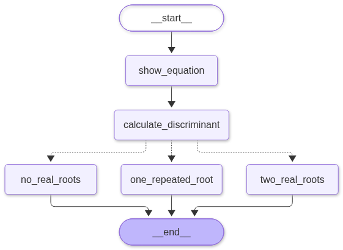
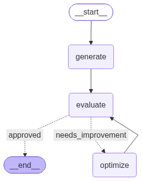
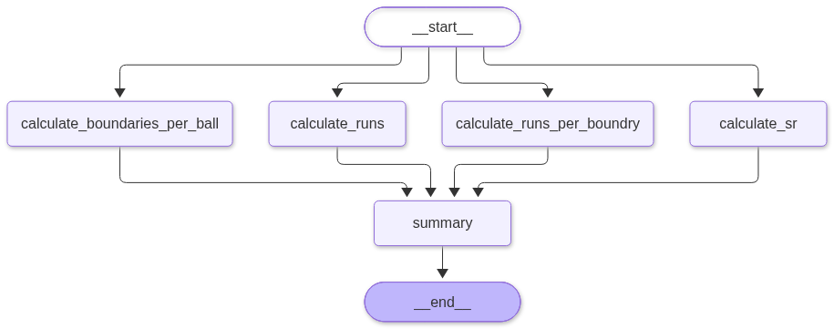
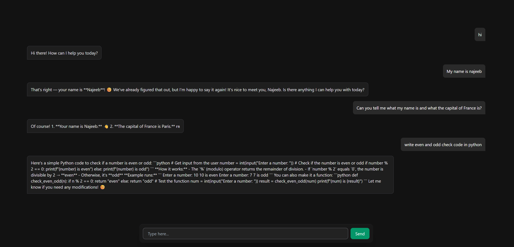
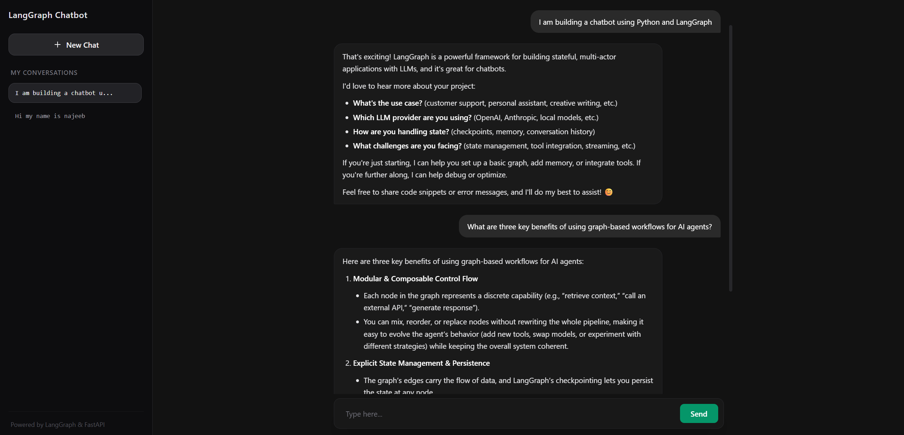
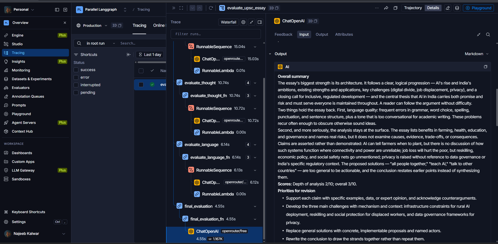

# AI Agent Workflows

A hands-on collection of AI and LLM application patterns built with **LangChain**, **LangGraph**, and related tools. This repository explores how to move from simple LLM calls to stateful, multi-step workflows and practical agent applications.

The examples cover graph-based orchestration, conditional routing, parallel execution, iterative refinement, conversation state, persistence, and experiments with LangSmith and retrieval-augmented generation (RAG).

## ✨ What’s Inside

- **LangGraph workflows** built with `StateGraph`, nodes, edges, and shared state
- **Conditional routing** to choose the next step from workflow state
- **Parallel execution** for independent tasks
- **Iterative refinement** using Generate → Evaluate → Optimize loops
- **Structured outputs** and input/output validation with Pydantic
- **Chatbots** with multi-turn conversations and checkpoint-based persistence
- **FastAPI integration** for exposing a chatbot through HTTP endpoints
- **LangSmith examples** and observability-focused experiments
- **RAG experiments** with multiple implementation iterations

## 🧭 Workflow Visualizations

The diagrams below show the main workflow patterns explored in this repository.

### Conditional Workflow

Routes execution to different paths according to a condition in the graph state.



### Iterative Workflow

Uses a feedback loop to generate an output, evaluate it, and refine it until it meets the target criteria.



### Parallel Workflow

Runs independent branches of work in parallel before combining or using their results.



## 💬 Chatbot Applications

### Basic LangGraph Chatbot

A simple conversational graph using a message-based state, an LLM node, and LangGraph's in-memory checkpointer. The example uses a thread ID to keep conversation turns associated with the same conversation.



### Chatbot with Persistent History

A fuller chatbot application built with **LangGraph**, **FastAPI**, and **SQLite checkpointing**. The notebook demonstrates:

- Multi-turn conversations identified by a `thread_id`
- Persistent conversation state through `AsyncSqliteSaver`
- Streaming assistant output from a FastAPI endpoint
- A chat-history endpoint for retrieving previous messages
- Pydantic request validation



Related implementation: [`ichatbot_workflow.ipynb`](ichatbot_workflow.ipynb).

## 🔭 LangSmith & LLM Experiments

The `langsmith/` directory contains a progression of Python examples covering simple LLM calls, sequential chains, RAG iterations, agents, and LangGraph. The image below is a visual reference for the LangSmith work in this repository.



Examples are available in the [`langsmith/` directory](langsmith/).

## 📂 Project Index

| Area | Files | What to explore |
| --- | --- | --- |
| Basic LLM workflow | `simplle_llm_workflow.ipynb` | A simple LLM-powered workflow |
| Sentiment / conditional routing | `conditional_workflow.ipynb` | Route graph execution based on a result |
| Iterative generation | `iterative_workflow.ipynb` | Generate, evaluate, and refine an output |
| Parallel execution | `parallel_workflow.ipynb`, `parallel_essay.ipynb` | Execute independent tasks in parallel |
| Basic chatbot | `chatbot.ipynb` | Stateful conversation using LangGraph |
| Chatbot application | `ichatbot_workflow.ipynb` | FastAPI, streaming, SQLite persistence, and history |
| BMI workflow | `bmi_workflow.ipynb` | A practical structured workflow example |
| LangSmith / RAG / agents | `langsmith/` | LLM calls, chains, RAG versions, agents, and LangGraph |

> Notebook and example filenames are kept as they currently exist in the repository.

## 🏗️ Core Architecture

The graph-based examples generally follow this execution model:

```text
User Input
    |
    v
Input Validation
    |
    v
Workflow State
    |
    v
LangGraph Nodes
    |
    +------> Conditional / Parallel / Iterative paths
    |
    v
Final State
    |
    v
Formatted Response
```

For the chatbot application, FastAPI exposes the graph to a client while LangGraph checkpointing stores conversation state by thread ID.

## 🛠️ Tech Stack

- **Language:** Python 3.12+
- **LLM orchestration:** LangChain, LangGraph
- **Models / providers:** OpenAI-compatible APIs, OpenRouter
- **API layer:** FastAPI
- **Validation:** Pydantic
- **Conversation persistence:** LangGraph checkpointing with SQLite
- **Observability experiments:** LangSmith
- **Environment configuration:** python-dotenv
- **Development:** Jupyter Notebook

## 🚀 Getting Started

### 1. Clone the repository

```bash
git clone https://github.com/NajeebKalwar/ai-agent-workflows.git
cd ai-agent-workflows
```

### 2. Create and activate a virtual environment

**Windows (PowerShell):**

```powershell
python -m venv .venv
.venv\Scripts\Activate.ps1
```

**Linux / macOS:**

```bash
python3 -m venv .venv
source .venv/bin/activate
```

### 3. Install dependencies

Install the packages required by the notebook or example you want to run. For the LangSmith examples, check the requirements file in the `langsmith/` directory:

```bash
pip install -r "langsmith/requirements (1).txt"
```

Some notebooks may require additional packages. Install those in the active virtual environment as needed.

### 4. Configure environment variables

Create a `.env` file in the project root and add the provider credentials used by the example you want to run:

```env
OPENROUTER_API_KEY=your_openrouter_api_key
# Add LANGSMITH_API_KEY and LangSmith project/tracing settings
# when running examples that use LangSmith.
```

Do not commit your real API keys or secrets.

### 5. Run a notebook

Start Jupyter:

```bash
pip install jupyter
jupyter notebook
```

Open the notebook you want to explore and run its cells in order.

## 📈 Learning Path

A suggested order for exploring the repository:

1. Start with a simple LLM call and understand model input/output.
2. Build a sequential workflow and pass results between steps.
3. Add conditional routing to make execution depend on state.
4. Run independent work in parallel.
5. Add an evaluator and an iterative refinement loop.
6. Build a chatbot and understand message state and thread IDs.
7. Add checkpoint persistence and expose the chatbot through FastAPI.
8. Explore RAG, agents, LangGraph, and LangSmith examples.

## 🗺️ Future Improvements

- Tool-calling agents
- Human-in-the-loop workflows
- Supervisor and multi-agent patterns
- More RAG workflows and retrieval evaluations
- Long-term memory patterns
- Automated tests and reusable application configuration

## 🤝 Contributing

Suggestions, fixes, and learning resources are welcome. Feel free to open an issue or submit a pull request.

## 📄 License

This repository currently describes the project as MIT licensed. Make sure a corresponding `LICENSE` file is present in the repository before relying on that license notice.

---

Built as a practical learning space for **LLM applications, LangChain, LangGraph, and AI agent engineering**.
