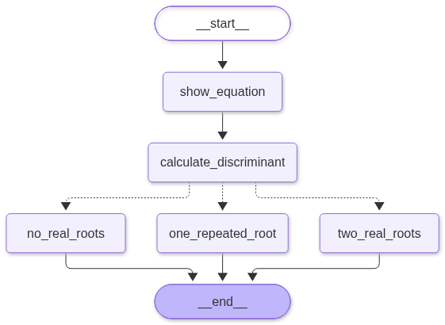
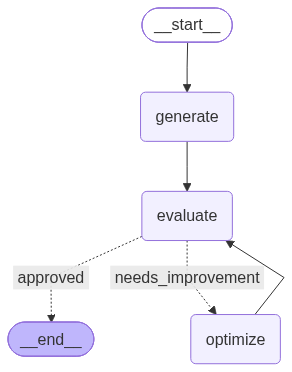
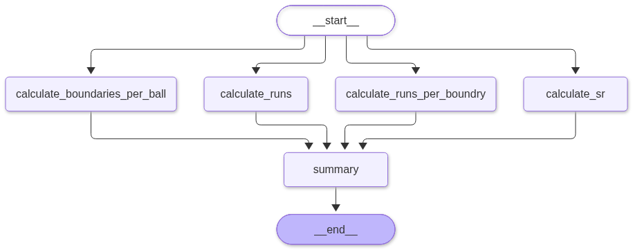
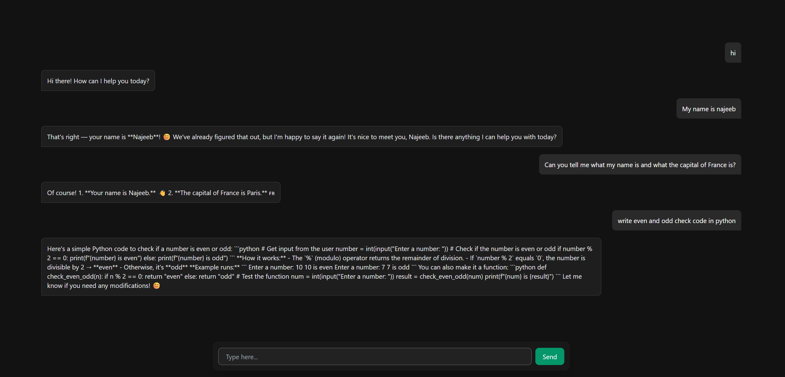

A collection of practical AI Agent workflows built using **LangGraph**, **LangChain**, and **LLMs**.

This repository demonstrates how to design, build, and orchestrate AI agents using graph-based workflows, structured outputs, conditional routing, state management, and iterative refinement loops.

---

## 🚀 Features

- LangGraph StateGraph workflows
- Agent routing with conditional edges
- Structured outputs using Pydantic
- LLM-powered decision making
- Generate → Evaluate → Optimize loops
- Sentiment Analysis Agent
- Tweet Generation & Optimization Agent
- Enterprise-style workflow patterns
- State management using TypedDict
- Input/Output validation with Pydantic

---
## 📸 Workflow Visualizations

### Conditional Workflow

This workflow demonstrates conditional routing based on state and decision logic.



---

### Iterative Workflow

This workflow demonstrates a Generate → Evaluate → Optimize feedback loop.



---

### Parallel Workflow

This workflow demonstrates parallel execution of multiple branches within a graph.



---

### Chatbot Workflow

An interactive full-stack AI chatbot powered by LangGraph and FastAPI, featuring multi-turn conversation persistence and a sleek Tailwind CSS frontend.
This workflow demonstrates data Persistence execution.



---


## 📂 Projects

### 1. Sentiment Analysis Workflow

Analyze text sentiment and route execution based on the result.

```text
START
  │
  ▼
Analyze Sentiment
  │
  ├── Positive
  ├── Negative
  └── Neutral
        │
        ▼
       END
```

Technologies:

- LangGraph
- LangChain
- OpenRouter
- Pydantic

---

### 2. Tweet Generation & Optimization Agent

An iterative AI agent that:

1. Generates a tweet
2. Evaluates tweet quality
3. Provides feedback
4. Optimizes the tweet
5. Re-evaluates until approved

Workflow:

```text
START
  │
  ▼
Generate Tweet
  │
  ▼
Evaluate Tweet
  │
  ├── Approved ─────────► END
  │
  └── Needs Improvement
                │
                ▼
           Optimize Tweet
                │
                ▼
           Evaluate Tweet
```

This demonstrates a classic:

**Generator → Evaluator → Refiner**

agent architecture.

---

## 🏗️ Architecture

The repository follows an enterprise-style design pattern:

```text
User Input
     │
     ▼
Pydantic Validation
     │
     ▼
DTO Object
     │
     ▼
LangGraph State
     │
     ▼
Workflow Execution
     │
     ▼
Final State
     │
     ▼
Response DTO
```

---

## 🛠️ Tech Stack

- Python 3.12+
- LangGraph
- LangChain
- OpenAI / OpenRouter
- Pydantic
- Jupyter Notebook
- dotenv

---

## 📦 Installation

Clone the repository:

```bash
git clone https://github.com/yourusername/ai-agent-workflows.git
cd ai-agent-workflows
```

Create virtual environment:

```bash
python -m venv myenv
```

Activate environment:

### Windows

```bash
myenv\Scripts\activate
```

### Linux / macOS

```bash
source myenv/bin/activate
```

Install dependencies:

```bash
pip install -r requirements.txt
```

---

## 🔑 Environment Variables

Create a `.env` file:

```env
OPENROUTER_API_KEY=your_api_key
```

---

## 📊 Visualizing Workflows

LangGraph workflow graphs can be visualized using:

```python
from IPython.display import Image

Image(workflow.get_graph().draw_mermaid_png())
```

---

## 🎯 Learning Objectives

This repository is designed to help developers learn:

- Agent Engineering
- Workflow Design
- State Management
- Prompt Engineering
- Structured Outputs
- Multi-step LLM Applications
- AI Agent Patterns

---

## 📚 Future Work

- Tool Calling Agents
- RAG Workflows
- Multi-Agent Systems
- Human-in-the-Loop Workflows
- Supervisor Agents
- Memory-enabled Agents
- Autonomous Task Execution

---

## 🤝 Contributions

Contributions, ideas, and improvements are welcome.

Feel free to fork the repository and submit pull requests.

---

## 📜 License

This project is licensed under the MIT License.

---

Built while learning and experimenting with AI Agents, LangGraph, and Agent Engineering.
